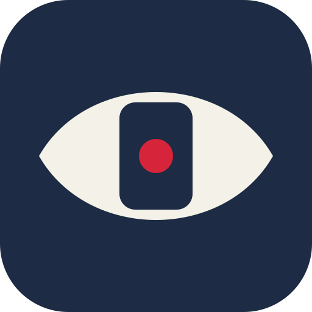
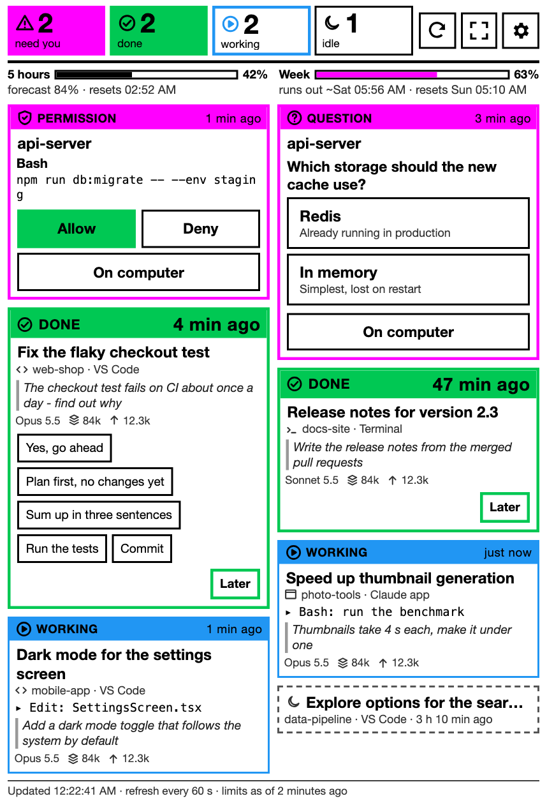
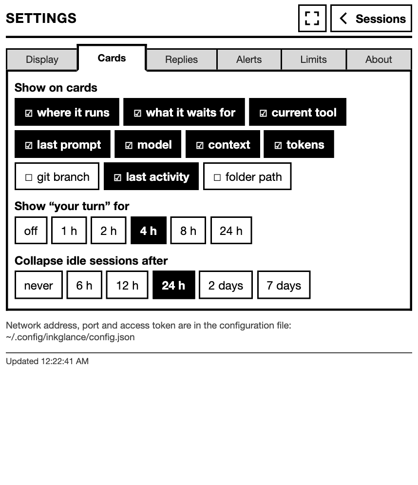
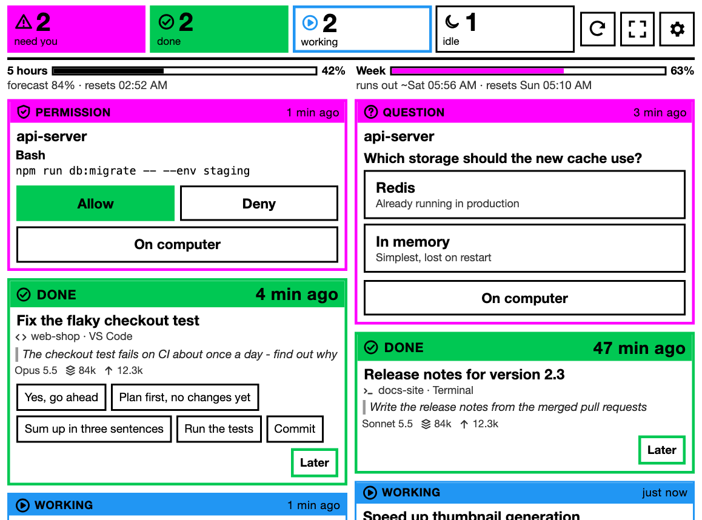

# InkGlance

[](https://github.com/maciejdzierzek/inkglance/actions/workflows/ci.yml)
[](LICENSE)

A calm, always-on panel for your Claude Code sessions, made for an e-ink reader
on your desk.

InkGlance runs a tiny web server on your computer. Any e-reader with a web browser
on the same Wi-Fi opens it and shows which sessions need you, which just finished
and are waiting for your next move, which are working and which are idle -
whether they run in a terminal, the VS Code extension or the Claude desktop app.
Plan limits, alerts, permission requests and one-tap replies included. No app
to install on the reader, no cable.

Built and tested on a PocketBook Verse Pro Color (Kaleido 3 color e-ink), but it
is plain HTML and works in any browser.





<sub>Screenshots from the built-in demo (`npm run demo`) - made-up sessions, real layout, actual reader size.</sub>

> **Status: early (0.1).** macOS is tested daily; Windows and Linux are in
> preview. See [Roadmap](#roadmap).

## What it shows

- **Four tiles** at the top, readable from across the desk: waiting for you,
  done (your turn), working, idle. A tile that wants you is filled with its
  color.
- **One board of cards**, most urgent first, packed into columns without gaps.
  Active cards have a colored state band with an icon and the time:
  - **Waiting**: permission prompts and Claude's questions, answerable
    right on the reader - *Allow* / *Deny*, or tap an option.
  - **Done · your turn**: the session's turn ended and it waits for
    your next message. A big counter ("12 min ago"), one-tap replies, and
    *Later* to put it aside until its next turn ends. The reader flashes, the
    computer plays a sound, the menu-bar icon shows `✓2` - the nudge to switch
    windows.
  - **Working**: current tool and last prompt.
  - **Idle**: two quiet lines; long-forgotten sessions collapse into one.
- **Per session** (you choose which): title, where it runs (Terminal, VS Code,
  Claude app), what it waits for, current tool, last prompt, model and effort,
  context size, output tokens, git branch, folder.
- **Plan limits** on one row: 5-hour and weekly usage, forecast at the current
  pace ("runs out ~Sat 05:18") and reset; tap for the **limits screen** with
  charts.
- **Colors you pick** for each state (color e-ink shows bright colors best;
  defaults are magenta, green and blue, and a color test page helps choose),
  or monochrome.
- Fullscreen, 1-3 columns, landscape, text size, English and Polish. Settings
  are big buttons - the only typing is for your own reply buttons.

## Requirements

- **macOS** (tested). **Windows and Linux: preview** - built and unit-tested,
  not yet run on a real machine. On Windows install manually (below): the
  plugin's hooks need `sh`, which Windows does not have.
- **Node.js 20+**
- **Claude Code** with the `claude` command on your PATH - the session list
  comes from `claude agents --json`. If you only use the desktop app or the VS
  Code extension, install the command-line `claude` as well.
- An e-reader (or any device) with a browser **on the same network**.

## Install

Pick **one** of the two ways - both install the same hooks, doing both gives
you every hook twice.

### A. As a Claude Code plugin (macOS, Linux)

In a Claude Code session (terminal, VS Code or the desktop app):

```
/plugin marketplace add maciejdzierzek/inkglance
/plugin install inkglance@inkglance
```

or in one line from a terminal:
`claude plugin install inkglance --marketplace maciejdzierzek/inkglance`.
Restart Claude Code, then run:

```
/inkglance:setup
```

The plugin brings the hooks. `/inkglance:setup` does the rest with you: checks
Node and Claude Code, puts the server in `~/.local/share/inkglance` (a git
clone), asks for language and port, starts the background service, suggests a
source for plan limits and walks you through pairing the reader.
`/inkglance:doctor` checks everything later.

### B. Manually (any system)

```sh
git clone https://github.com/maciejdzierzek/inkglance.git
cd inkglance
npm run hooks:install     # four hooks in ~/.claude/settings.json, with a backup
npm start                 # or the menu-bar app / background service below
```

Prefer to be guided? Open Claude Code in the folder and say *"Follow
commands/setup.md to set up InkGlance for me"*.

### Try it first, without touching Claude Code

In a clone (step B without `hooks:install`):

```sh
npm run demo              # made-up sessions on port 4800; prints the address
```

## Pair the reader

The server prints its address, such as `http://192.168.0.10:4747`. Open it in
the e-reader's browser. Instead of a long token, the page shows a keypad: type
the **6-digit code** from the notification on your computer. The code is also in
the terminal, or in the log when InkGlance runs as the app or service (*Show
log*, `npm run service:logs`). Then bookmark the page - you will not need a code
again.

- **Shorter address on macOS:** set `"port": 80` in the config file and the
  address becomes `http://192.168.0.10`. This also helps browsers that try
  `https://` first. (On Linux, port 80 needs root - keep the default.)
- macOS may ask whether Node may accept incoming connections - allow it. On
  Windows and Linux, allow the port in the firewall.
- **Set up the reader** so it stays on and connected:
  [docs/e-readers.md](docs/e-readers.md).

## Keep it running

### Menu-bar app (macOS)

```sh
npm run tray:install   # builds InkGlance.app, installs it to ~/Applications, opens it
```

Or download it from [Releases](https://github.com/maciejdzierzek/inkglance/releases)
(macOS `.dmg`; a Windows installer as a preview). The builds are not signed
yet: macOS asks you to confirm opening the app (right-click → *Open*), Windows
SmartScreen asks too. Building yourself needs Rust and the Xcode command-line
tools. Either way, the app runs the server with your own Node.

An eye icon in the menu bar - with the number of sessions waiting for you and
`✓N` for finished turns - and a menu: status, the address for the reader, *Open
panel*, *Settings…*, *Limits…*, *Restart server*, *Show log*, *Open at login*,
*Quit*. The app carries its own copy of the server and replaces the background
service below.

### Background service without the app (macOS)

```sh
npm run service:install    # starts at login, restarts if it stops
npm run service:status
npm run service:logs       # pairing codes are printed here too
npm run service:uninstall
```

Run `service:install` again after updating InkGlance or Node.

## Answering from the reader

The four hooks (`src/hook.sh`, a small shell script with curl; a Node version on
Windows) work in the terminal, the VS Code extension and the desktop app, next
to any hooks you already have.

```sh
npm run hooks:status
npm run hooks:uninstall   # removes only InkGlance's entries (with a backup)
```

### Replies: in parallel with the computer

When a session finishes its turn, a **Stop** hook with Claude Code's
`asyncRewake` option starts in the background. The session stays idle and fully
usable on the computer - answer there whenever you like. Meanwhile the reader
shows reply buttons on that session. Tap one and the hook wakes Claude with
your reply. Type on the computer first and a **UserPromptSubmit** hook closes
the reader's reply slot. Unused slots expire after 4 hours (setting *Keep
replies open for*). Each waiting session costs one idle curl process (about
5 MB). Edit the buttons on the reader (Settings → Replies) or as `templates` in
the config file.

### Permission requests and questions: when you are away

A **PermissionRequest** hook brings permission requests to the reader, and a
**PreToolUse** hook on `AskUserQuestion` brings Claude's multiple-choice
questions (the answer fills the tool's own `answers` field, so Claude receives
it exactly like an answer typed on the computer).

Neither can be answered in parallel: while the panel holds a request, Claude
Code does not show its own dialog. So by default (*when I'm away*) InkGlance
holds a request only when your keyboard and mouse have been idle for a minute,
and hands it back the moment you touch them. At your desk you answer on the
computer as usual. Other modes: *always* and *never*.

- The hook fails open: panel not running, no config, any error - it exits at
  once and Claude Code shows its normal dialog. It never approves anything by
  itself.
- *On computer* hands the request back; after a timeout (default 5 minutes) it
  is handed back automatically.
- Only Claude Code on the same computer can submit requests (loopback + token);
  only a paired reader can answer them.

## Where the data comes from

| | Terminal (`claude`) | VS Code extension | Claude desktop app |
|---|---|---|---|
| Session list and status | yes | yes | yes |
| Details, "your turn" (from transcripts) | yes | yes | yes |
| Plan limits via status line | yes | no | no |
| Plan limits via Claude Code Usage extension | yes* | yes* | yes* |
| Plan limits via the usage endpoint | fallback | fallback | fallback |
| Alerts | yes | yes | yes |

\* Limits are per account, not per session: one source covers every session.

- **Session list and status**: `claude agents --json`, the documented way to
  list active Claude Code sessions.
- **Details and "your turn"**: each session's transcript in
  `~/.claude/projects/`. The format is internal to Claude Code, so InkGlance
  reads it on a best-effort basis: if a future version changes it, some details
  disappear, the list stays.
- **Plan limits** (Pro / Max subscriptions) - the cheapest source available
  (setting *Limits source*, default *automatic*):
  1. **[Claude Code Usage](https://marketplace.visualstudio.com/items?itemName=growthjack.claude-code-usage)**
     ([source](https://github.com/ClaudeCodeUsage/ClaudeCodeUsage), MIT, by another
     author) - a VS Code extension that tracks your plan quota. InkGlance only
     **reads the file it keeps on your disk**
     (`…/Code/User/globalStorage/growthjack.claude-code-usage/quota-observations-v2.json`):
     for each window (5 hours, week) the used fraction, the reset time and when
     it was observed - nothing else, no request of its own. The extension
     itself talks to Anthropic with your Claude Code login to get those numbers;
     what it does and stores is described in its README - read it before
     installing. Install: `code --install-extension growthjack.claude-code-usage`.
  2. **Status line** - Claude Code passes plan limits to status line commands.
     `npm run statusline:print` prints a `statusLine` entry for
     `~/.claude/settings.json`. **If you already have a status line, it would
     replace it** - merge by hand. Terminal sessions only.
  3. **Usage endpoint** at api.anthropic.com, with the login Claude Code stores
     (macOS Keychain - macOS may ask for access - or
     `~/.claude/.credentials.json`). Used only when nothing local is fresh, at
     most every 15 minutes, honoring Retry-After: the endpoint is undocumented
     and strictly rate limited. The token is never stored or refreshed.

## Configuration

Settings live in `~/.config/inkglance/config.json` (override with
`INKGLANCE_CONFIG`), created on first start. Everything except the network,
binary path and token can also be changed on the panel's **Settings** screen.
`npm run config` reads and writes it from the terminal (`get`, `set`, `url`).

| Key | Default | Meaning |
|---|---|---|
| `language` | `en` | `en`, `pl` |
| `refreshSeconds` | `60` | Full refresh interval (15-3600). Changes show sooner: the reader checks every 10 s |
| `columns` | `2` | `1`, `2`, `3` |
| `orientation` | `auto` | `auto` follows the browser; `left` / `right` draw the page sideways |
| `cardFields` | most | `where`, `waitingFor`, `activity`, `lastPrompt`, `model`, `context`, `tokens`, `branch`, `times` (time in the band), `path` |
| `finishedHours` | `4` | How long a finished turn stays in "your turn" before the session counts as idle (0 = off) |
| `hideIdleAfterHours` | `24` | Collapse idle sessions older than this (0 = never) |
| `fontScale` | `1` | `0.875` to `1.5` |
| `color` | `true` | `false` for monochrome screens |
| `colorNeedsYou`, `colorFinished`, `colorWorking` | `#ff00ff`, `#00c853`, `#2196f3` | State colors, any `#rrggbb`; pick them on the reader in Settings → Display |
| `showDiagnostics` | `true` | Viewport and browser line in the footer, also reported to the log |
| `alertOn` | `["needsYou", "finished"]` | What to alert on |
| `macSound`, `macSoundName` | `true`, `Glass` | Sound on the computer: `Glass`, `Ping`, `Submarine`, `Hero` |
| `macNotification` | `false` | System notification on the computer |
| `readerFlash` | `true` | Flash the reader's screen |
| `quietHours` | `off` | `21-8`, `22-7`, `23-7` |
| `showLimits` | `true` | Plan limits strip |
| `usageSource` | `auto` | `auto`, `extension`, `statusline`, `api`, `off` |
| `usageApiMinutes` | `15` | Minimum minutes between usage endpoint requests |
| `approvals` | `away` | Answer permission requests on the reader: `off`, `away`, `always` |
| `awaySeconds` | `60` | Idle keyboard and mouse time that counts as away |
| `approvalTimeoutMinutes` | `5` | Hand a request back to the computer after this |
| `replies` | `true` | Reply buttons on finished sessions |
| `replyWindowHours` | `4` | How long a finished session accepts a reply from the reader (1-24) |
| `templates` | `[]` | Your reply buttons, e.g. `["Yes, continue", "Commit"]`; empty = defaults |
| `updateCheck` | `true` | Daily check for a new release |
| `host`, `port` | `0.0.0.0`, `4747` | Where the server listens (file only) |
| `allowedHosts` | `[]` | Extra host names the panel answers to, e.g. a VPN name (file only) |
| `claudeBin` | `claude` | Path to the Claude Code binary (file only) |
| `token` | generated | Access token (file only) |

Adding a language: copy `src/locales/en.json` to `src/locales/<code>.json`,
translate, and add the code to `LANGUAGES` in `src/config.js`. A test checks
that no key is missing.

## Updates

InkGlance checks once a day whether a newer release exists (one anonymous request
to the GitHub API; switch it off under Settings → About). A new version shows as
a badge in the panel, in Settings → About and in the menu-bar app's menu.

- **Git checkout** (manual install, and the plugin's server in
  `~/.local/share/inkglance`): *Install* in Settings → About, on the computer
  itself, runs `git pull --ff-only` and restarts the panel. Note: this brings
  the latest commit of your branch, not exactly the release.
- **Plugin hooks**: `claude plugin marketplace update inkglance`, then
  `claude plugin update inkglance@inkglance` (or the `/plugin` menu) and
  restart Claude Code. Plugins from other authors do not update automatically
  by default. Run `/inkglance:setup` afterwards to update the server too.
- **Menu-bar app**: the menu item opens the release page; download and replace
  the app. One-click signed updates are planned.

Maintainers: [docs/releasing.md](docs/releasing.md).

## Privacy

InkGlance has no telemetry and no account.

- **Reads on your computer:** the session list (`claude agents --json`),
  session transcripts in `~/.claude/projects/` (titles, prompts, token counts),
  the Claude Code Usage extension's quota file (if you installed that
  extension - see [Where the data comes from](#where-the-data-comes-from)),
  keyboard/mouse idle time (for *when
  I'm away*), and - only for the usage endpoint fallback - the login Claude Code
  stores.
- **Writes on your computer:** `~/.config/inkglance/` (config with the access
  token, `hook.env` and `hook.header` for the hooks, usage history,
  status-line snapshots), and a log (`~/Library/Logs/inkglance.log` for the app
  and service) with request lines and device addresses.
- **Sends over the internet:** at most every 15 minutes, and only when no local
  limits source is fresh, a request to api.anthropic.com with your Claude Code
  login; once a day an anonymous request to api.github.com for the latest
  release (switch off: `updateCheck`). Nothing else.
- **On your local network:** the panel - project names, titles, prompts - over
  plain HTTP to paired devices.

## Security

Anyone holding the access token can approve commands and send messages to your
sessions, so the panel is guarded in layers:

- Every page requires the token. A device gets it once by pairing with a
  6-digit code: 10-minute lifetime, 5 attempts, at most 3 codes an hour, each
  announced on the computer.
- Only private networks (home Wi-Fi, link-local, VPN ranges such as
  Tailscale's) may connect, and requests must name the computer by IP address,
  `localhost`, its own name or an entry in `allowedHosts` - this stops web pages
  from reaching the panel through DNS tricks.
- Hooks are accepted only from this computer; installing updates only from this
  computer. Network, binary path and token can be changed only in the config
  file.
- The panel uses plain HTTP: on a shared network (café, office), others could
  see the traffic. Use it on a network you trust; do not expose the port to the
  internet. All paired devices share one token - to revoke them, delete
  `token` from the config and restart.

See [SECURITY.md](SECURITY.md) for reporting vulnerabilities.

## FAQ

- **Does it work with Kindle, Kobo or Boox?** Anything with a reasonably modern
  browser should; it is tested on a PocketBook. Reports welcome
  ([e-reader report](../../issues/new?template=reader.yml)).
- **Does it ever approve something by itself?** No. Every approval is a tap on
  a paired device; if the panel is off, Claude Code behaves as if InkGlance did
  not exist.
- **Do I need a Pro or Max plan?** No. Sessions, "your turn", replies and
  approvals work with any Claude Code login; plan limits need a subscription
  that has them.
- **Does it work over the internet?** Not by design. Over a VPN such as
  Tailscale it works like at home (add the name to `allowedHosts` if you use
  one).
- **Does it slow Claude Code down?** No. When the panel is not running, the
  hooks exit at once. Replies wait in the background; permission requests are
  held only while you are away from the keyboard (the default).

## Troubleshooting

- **The reader cannot open the page** - check both are on the same network; type
  `http://` explicitly (some browsers try `https://` first); allow incoming
  connections for Node (macOS prompt, Windows/Linux firewall). Opening by a
  host name other than the computer's? Add it to `allowedHosts`.
- **"Too many codes this hour"** - a guard against guessing. Wait the minutes
  shown, or restart InkGlance.
- **No sessions listed** - run `claude agents --json` in a terminal. If the
  command is not found, install the command-line Claude Code or set `claudeBin`
  to its full path (apps started from Finder do not see your shell's PATH).
- **Every hook runs twice** - you installed both the plugin and the manual
  hooks: `npm run hooks:uninstall` keeps the plugin's.
- **Limits show an error or "429"** - the usage endpoint is rate limited;
  install the Claude Code Usage extension or use the status line instead.
- **Anything else** - `/inkglance:doctor`, then the log (*Show log*,
  `npm run service:logs`).

## Uninstall

1. Hooks: `claude plugin uninstall inkglance@inkglance` (plugin) or
   `npm run hooks:uninstall` (manual).
2. The app: switch off *Open at login*, *Quit* it from its menu, delete
   `~/Applications/InkGlance.app`. Or the service: `npm run service:uninstall`.
3. Files: `~/.local/share/inkglance` (plugin's server), `~/.config/inkglance/`
   (config, token, history), `~/Library/Logs/inkglance.log`.
4. If you added the status line: remove the `statusLine` entry from
   `~/.claude/settings.json`.

## Roadmap

1. Session list, settings, alerts, plan limits - **done**
2. Allow / deny permission requests, one-tap replies - **done**
3. Usage charts - **done**
4. Answer Claude's multiple-choice questions from the reader - **done**
5. "Your turn" for finished sessions - **done**
6. Menu-bar app - **done** for macOS; Windows and Linux in preview
7. Update checks - **done**; signed one-click app updates with the first release
8. Jump to the session's window on the computer

## Development

```sh
npm test          # unit tests
npm run lint      # ESLint + Knip (unused files and exports)
npm run check     # private-data guard, gitleaks, lint, ShellCheck, tests (runs before every push)
npm run demo      # the panel with made-up data, for screenshots
git config core.hooksPath .githooks   # once per clone
```

Zero runtime dependencies. Screenshots and examples use made-up data only.
See [CONTRIBUTING.md](CONTRIBUTING.md) and the [Code of Conduct](CODE_OF_CONDUCT.md).

## Credits

- **[Claude Code Usage](https://github.com/ClaudeCodeUsage/ClaudeCodeUsage)**
  (MIT) - InkGlance reads its local quota file as the preferred, zero-request
  source of plan limits. No code is taken from it.
- **[Tauri](https://tauri.app)** (MIT / Apache-2.0) - the menu-bar app, with
  its plugins and Rust crates (MIT / Apache-2.0 and compatible); every app
  build carries their notices in `THIRD-PARTY-NOTICES.txt`.
- **[Contributor Covenant](https://www.contributor-covenant.org)** (CC BY 4.0) -
  our [Code of Conduct](CODE_OF_CONDUCT.md).
- **Ideas, no code:** answering Claude from another device -
  [claude-agents-dashboard](https://github.com/futin/claude-agents-dashboard);
  a menu-bar session counter - [cc-status-bar](https://github.com/usedhonda/cc-status-bar);
  e-ink layout principles (big numbers, little text) - the
  [TRMNL design system](https://trmnl.com/blog/design-system).
- Built with [Claude Code](https://claude.com/claude-code). Icons drawn for
  InkGlance.

## License

MIT
